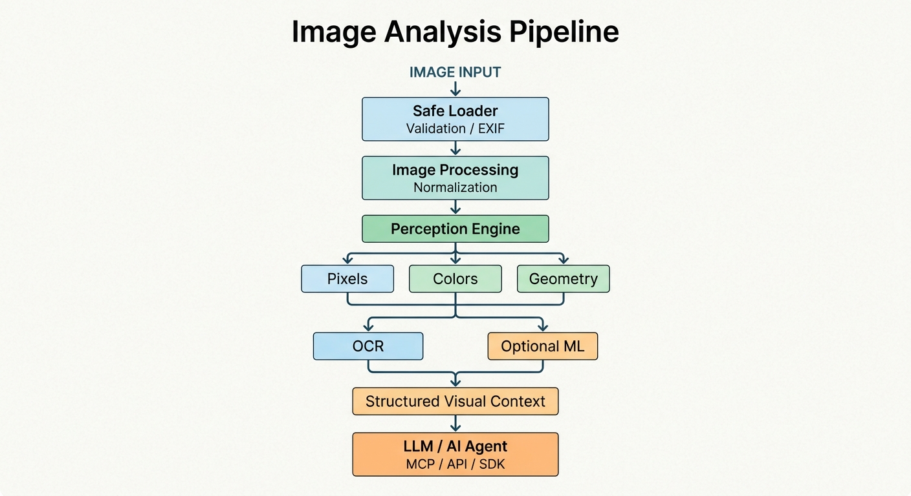

# Visualis

### Universal Visual Intelligence Layer for Text-Based AI Agents

**Give any AI agent the ability to understand images — without requiring multimodal LLMs, GPUs, or mandatory cloud APIs.**

Visualis is an open-source visual perception framework that transforms raw images into structured, machine-readable intelligence.

It enables text-only LLMs and autonomous agents to work with screenshots, photographs, diagrams, interfaces, documents, and other visual content through deterministic computer vision, optional machine-learning backends, and evidence-based analysis.

No proprietary vision models. No mandatory API keys. No GPU required.

<p align="center">
  
  
  
  
</p>

---

## The Problem

Most AI agents interact with the world through text.

They can reason, write code, execute commands, browse the internet, and use external tools. However, when presented with an image, screenshot, or visual interface, text-only models have no native way to interpret its contents.

This creates a significant limitation for autonomous agents.

They cannot reliably:
- Understand the structure of a screenshot.
- Extract text from visual interfaces.
- Identify dominant colors and visual regions.
- Analyze geometric relationships.
- Inspect image composition and visual properties.
- Convert visual information into structured context.

Traditional solutions rely on multimodal models or external vision APIs, introducing additional costs, dependencies, privacy concerns, and infrastructure requirements.

**Visualis takes a different approach.**

Instead of requiring an AI model to see, it processes images locally and translates visual information into structured evidence that existing text-based models can understand.

## How It Works

<p align="center">
  
</p>

The perception engine combines deterministic image analysis with optional inference backends.

Every analysis result carries metadata about its origin, execution status, and confidence where applicable.

This allows an agent to distinguish measured pixel information from OCR output or model-generated predictions.

---

## Core Capabilities

### 1. Pixel Intelligence

Extract precise visual information directly from image data.

- Exact pixel sampling.
- Dominant color extraction.
- Color distribution and histograms.
- Region-based statistical analysis.
- Image dimensions and metadata.
- RGB and other color-space measurements.

### 2. Geometric Analysis

Understand the structural properties of an image without requiring a neural network.

- Edge detection.
- Harris corner detection.
- Symmetry analysis.
- Noise estimation.
- Blur and sharpness metrics.
- Basic structural measurements.

### 3. Optical Character Recognition

Extract readable text from visual content using optional OCR backends.

Supported integrations:

- RapidOCR (ONNX Runtime).
- Tesseract.

OCR results include confidence information and extracted text regions where supported by the backend.

### 4. Optional Visual Intelligence Backends

Extend the deterministic perception engine with machine-learning capabilities.

The provider architecture is designed to support:

- Object detection.
- Image classification.
- Semantic segmentation.
- Advanced visual recognition.

These capabilities are optional and depend on the configured backend and available models.

### 5. Evidence-Based Results

Visualis does not treat every observation as equally reliable.

Each result identifies its evidence source, allowing downstream agents to evaluate information according to its origin.

| Evidence Source | Origin |
|---|---|
| `PIXEL_MEASUREMENT` | Direct pixel measurements |
| `GEOMETRIC_ANALYSIS` | Computed image properties |
| `OCR_DETECTION` | OCR backend output |
| `OBJECT_DETECTION` | Object detection inference |
| `SEMANTIC_PROVIDER` | External semantic provider |

Confidence values are backend-dependent and should not be interpreted as universal probabilities.

---

## Quick Start

### Installation

Minimal installation:

```bash
pip install visualis
```

Optional OCR backends:

```bash
# ONNX-based OCR
pip install "visualis[ocr-rapid]"

# Tesseract OCR
pip install "visualis[ocr]"
```

Full installation:

```bash
pip install "visualis[all]"
```

### Basic Usage

```python
from visualis import inspect

context = inspect("screenshot.png", depth="standard")

# Extract recognized text
print(context.ocr_text())

# Access structured color information
colors = context.module("colors")

print(colors.payload["dominant_colors"])

# Access image metadata
metadata = context.results["metadata"]

print(f"Dimensions: {metadata.payload['width']}x{metadata.payload['height']}")

# Export the complete analysis
print(context.to_json())
```

### Selective Analysis

You don't always need a complete image inspection.

Run only the modules required by your application:

```python
context = inspect(
    "screenshot.png",
    tasks=["pixels", "colors", "ocr"]
)
```

This reduces unnecessary processing and gives developers more control over execution.

---

## Analysis Depths

Visualis provides three analysis profiles.

| Depth | Processing | Intended Use |
|---|---|---|
| `fast` | Metadata, pixels, colors | Lightweight inspection |
| `standard` | Fast + geometry + OCR | General-purpose perception |
| `deep` | Extended analysis and configured advanced backends | Comprehensive inspection |

The actual modules executed depend on installed optional dependencies and backend configuration.

---

## Built for AI Agents

Visualis is designed to work as an independent perception layer.

It does not need to control the LLM, manage conversations, or replace an agent framework.

Instead, it provides visual context that can be consumed by any compatible system.

### MCP Integration

Expose visual perception directly to MCP-compatible agents.

Start the server:

```bash
visualis-mcp
```

Available tools:

| Tool | Description |
|---|---|
| `visualis.inspect_image` | Execute a configurable image inspection |
| `visualis.ocr_image` | Extract text from an image |

Python integration:

```python
from visualis.interfaces.mcp.server import create_mcp_server

server = create_mcp_server()
```

### REST API

A REST API is planned as an additional integration interface.

### CLI

Inspect images directly from your terminal:

```bash
visualis inspect image.png
visualis ocr screenshot.png
visualis detect image.png
visualis compare image1.png image2.png
```

Some commands require optional backends and configuration.

---

## Architecture

Visualis follows a modular architecture designed for extensibility, isolation, and maintainability.

```text
src/visualis/
│
├── core/
│   ├── schemas.py
│   ├── config.py
│   └── engine.py
│
├── processing/
│   └── loader.py
│
├── perception/
│   ├── pixels/
│   ├── colors/
│   ├── geometry/
│   ├── ocr/
│   └── detection/
│
├── providers/
│   ├── interfaces.py
│   ├── onnx/
│   └── semantic/
│
└── interfaces/
    ├── mcp/
    ├── cli/
    └── api/

tests/
├── unit/
├── integration/
├── benchmarks/
└── fixtures/
```

### Design Principles

- **Modularity:** Perception modules operate independently.
- **Extensibility:** New providers can be integrated without redesigning the core.
- **Portability:** The deterministic processing layer runs locally.
- **Transparency:** Results include evidence provenance.
- **Graceful degradation:** Missing optional dependencies should not prevent unrelated capabilities from working.
- **Agent compatibility:** Structured outputs are designed for programmatic consumption.

---

## Security and Reliability

Images are untrusted input.

Visualis treats image processing as a security boundary rather than assuming that uploaded files are safe.

Current security mechanisms include:

- Decompression-bomb protection through pixel limits.
- EXIF orientation normalization.
- Path traversal rejection.
- SVG sanitization and restricted rasterization.
- Lazy loading of external provider credentials.
- No execution of embedded image metadata.
- OCR output marked as untrusted external content.

### Prompt Injection Protection

Images may contain text designed to manipulate an AI agent.

Visualis does not treat recognized text as executable instructions.

OCR output is classified as untrusted data by default. Downstream agents must not follow instructions extracted from images without explicit authorization from the user.

**Visual information is evidence, not authority.**

---

## Supported Formats

| Format | Support |
|---|---|
| PNG | Yes |
| JPEG | Yes |
| WEBP | Yes |
| BMP | Yes |
| TIFF | Yes |
| GIF | First frame by default |
| SVG | Restricted rasterization |

SVG processing requires a supported rasterization backend, such as CairoSVG, Inkscape, or `rsvg-convert`.

---

## Configuration

Visualis uses environment variables prefixed with `VISUALIS_`.

| Variable | Default | Description |
|---|---|---|
| `VISUALIS_MAX_PIXELS` | `16000000` | Maximum permitted image pixels |
| `VISUALIS_OCR_CONFIDENCE_FLOOR` | `0.5` | Minimum OCR confidence threshold |
| `VISUALIS_LOG_LEVEL` | `INFO` | Logging verbosity |

External provider credentials are loaded lazily and are not included in configuration dumps.

---

## Development

Clone the repository:

```bash
git clone https://github.com/visualis/visualis.git
cd visualis
```

Create the development environment:

```bash
uv venv --python 3.13
source .venv/bin/activate
uv pip install -e ".[dev]"
```

Run tests:

```bash
# Deterministic unit tests
pytest tests/unit/

# Optional backend integration tests
pytest tests/integration/

# Performance benchmarks
pytest tests/benchmarks/
```

The unit test suite is designed to run without optional inference backends.

---

## Roadmap

Visualis is being developed toward a comprehensive, modular visual perception framework.

- [ ] YOLO-based object detection with proper NMS post-processing.
- [ ] Semantic segmentation using classical CV and optional ONNX models.
- [ ] Chart and diagram interpretation.
- [ ] Advanced image comparison.
- [ ] Tiled processing for large images.
- [ ] REST API with authentication.
- [ ] Docker deployment support.
- [ ] Improved visual region and spatial relationship analysis.
- [ ] Expanded benchmarking and backend evaluation.

Roadmap items represent planned work, not currently available functionality.

---

## Philosophy

Visualis is built around a simple idea:

**An AI agent shouldn't need a multimodal model just to extract useful information from an image.**

Many visual properties can be measured directly. Text can be extracted through local OCR. Geometric structures can be analyzed algorithmically. More advanced recognition can be added when necessary.

By separating perception from reasoning, Visualis makes visual capabilities more accessible, portable, and composable.

It doesn't try to replace vision models.

It provides an independent visual intelligence layer that text-based AI systems can use.

---

## License

Visualis is released under the [MIT License](LICENSE).

---

<p align="center">
  <strong>Visualis — Making visual perception accessible to every AI agent.</strong>
</p>
